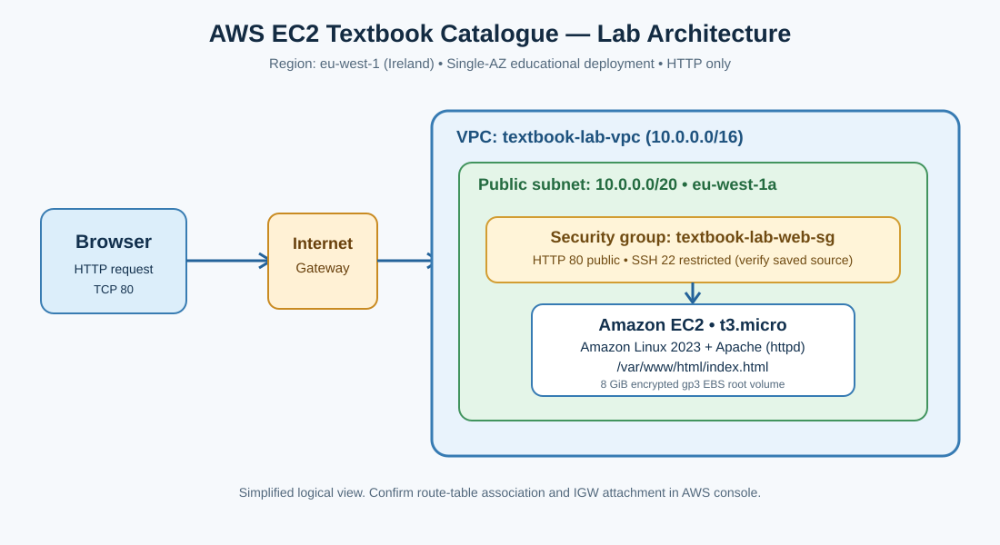
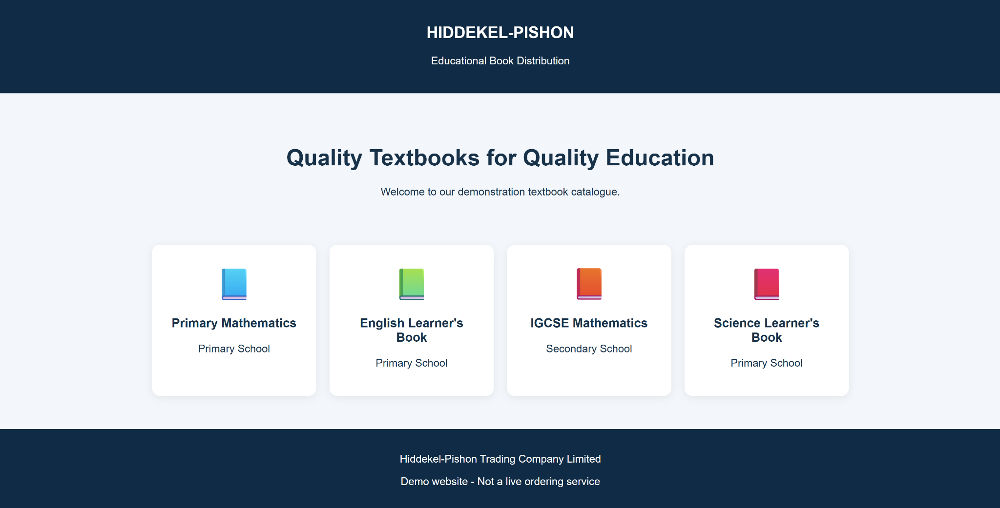

## AWS Architecture Diagram

The following diagram illustrates the AWS infrastructure used to host the textbook catalogue website.

## Screenshot Evidence

The screenshot below shows the successfully deployed textbook catalogue website running on Amazon EC2.

## Project Documentation

- [Deployment Guide](docs/deployment-guide.md)
- [Security Configuration](docs/security.md)
- [Troubleshooting Guide](docs/troubleshooting.md)
- [Cost Management and Cleanup](docs/cost-and-cleanup.md)
